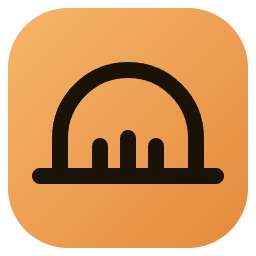
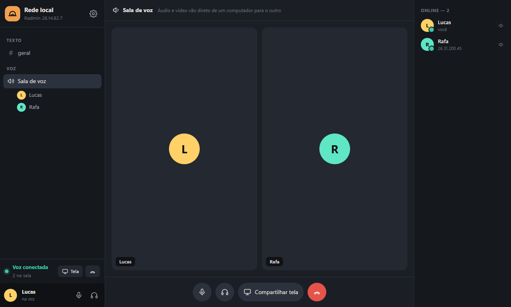
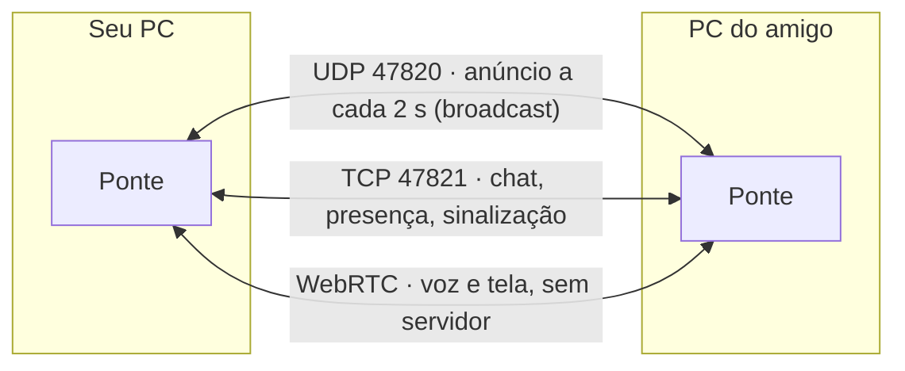

<div align="center">



# Ponte

**Chat, voz e compartilhamento de tela direto entre computadores da mesma rede.**<br>
Feito para jogar com os amigos pelo Radmin VPN, sem servidor e sem conta.

[**⬇ Baixar para Windows**](https://github.com/vinceprogamations/ponte/releases/latest/download/Ponte-Instalar.exe)
&nbsp;·&nbsp; [Todas as versões](https://github.com/vinceprogamations/ponte/releases)



</div>

## Instalar (um arquivo só)

1. Baixe o **[Ponte-Instalar.exe](https://github.com/vinceprogamations/ponte/releases/latest/download/Ponte-Instalar.exe)** e dê dois cliques nele.
2. Se aparecer *"O Windows protegeu o computador"*, clique em **Mais informações → Executar assim mesmo**.
   O aviso aparece porque o app não é assinado digitalmente.
3. Aceite o pedido de administrador. O instalador coloca a Ponte em *Arquivos de Programas*, cria
   atalhos e **libera o app no firewall em todas as redes**, inclusive na do Radmin, que o Windows
   costuma tratar como pública.
4. A Ponte abre sozinha no final. Pronto.

> Seu amigo faz a mesma coisa. Com os dois na **mesma rede do Radmin VPN**, um aparece na lista
> **Online** do outro automaticamente.

## O que tem

| | |
|---|---|
| 💬 **Chat** | Canal `#geral` com histórico salvo nos dois computadores e sincronizado quando alguém volta. |
| 🎙️ **Voz** | Sala de voz com cancelamento de eco e ruído, silenciar e ensurdecer, volume por pessoa e indicador de quem está falando. |
| 🖥️ **Tela** | Compartilhe uma tela ou janela em **480p, 720p ou 1080p**, a **30 ou 60 fps**, com o som do computador se quiser. Clique para ampliar e dê dois cliques para tela cheia. |
| 📡 **Descoberta automática** | Sem digitar IP: a Ponte encontra quem está na rede. Se precisar, dá para adicionar um IP manualmente. |
| 🔒 **Sem servidor** | Tudo vai direto de um computador para o outro. Nada passa pela internet além do próprio Radmin. |


## O amigo não aparece?

- Confira se os dois estão online **na mesma rede** do Radmin e se um consegue dar `ping` no IP do outro.
- Abra **Configurações** (engrenagem) → *IPs adicionados manualmente* e coloque o IP do Radmin do amigo
  (o que começa com `26.`).
- Em Configurações, *Diagnóstico da rede* mostra o que a Ponte está vendo.

## Como funciona



- **Descoberta:** cada Ponte anuncia "estou aqui" por UDP no broadcast de cada placa de rede,
  inclusive `26.255.255.255` do Radmin, e por unicast para IPs já conhecidos.
- **Canal de controle:** uma conexão TCP por amigo leva o chat, o estado (na voz, mudo, transmitindo)
  e a negociação do WebRTC.
- **Mídia:** WebRTC ponto a ponto **sem STUN/TURN**, usando só os IPs locais e da VPN. Se a conexão
  não sobe em cerca de 10 s, ela é refeita sozinha.

## Estrutura

```
ponte/
├── src/
│   ├── main/            processo principal do Electron
│   │   ├── main.js      janela, captura de tela, histórico, IPC
│   │   ├── lan.js       descoberta UDP + conexões TCP (Node puro)
│   │   └── preload.js   ponte segura entre a interface e o main
│   └── renderer/        interface (HTML/CSS/JS) e WebRTC
├── build/               ícone e script extra do instalador (firewall)
├── scripts/             utilitários (gerar ícone)
├── test/                teste da camada de rede
├── docs/img/            capturas de tela
└── .github/workflows/   gera o instalador e publica a Release a cada tag
```

## Desenvolvimento

Requer Node.js 22 ou mais novo.

```bash
npm install
npm start          # abre o app
npm test           # sobe dois nós locais e testa descoberta, mensagens e reconexão
npm run dist       # gera dist/Ponte-Instalar.exe
```

Para lançar uma versão nova, suba a versão no `package.json` e envie uma tag. O GitHub Actions gera o
instalador e publica a Release:

```bash
git tag v1.0.1
git push origin v1.0.1
```

<details>
<summary>Testar com duas janelas na mesma máquina</summary>

```bash
PONTE_AUTOTEST=1 PONTE_PROFILE=./perfil-a PONTE_NAME="Ana compartilha" npx electron .
PONTE_AUTOTEST=1 PONTE_PROFILE=./perfil-b PONTE_NAME="Beto" npx electron .
```

O modo de teste usa um microfone falso, entra na voz sozinho e imprime no terminal o estado da conexão
e os bytes de áudio e vídeo recebidos. Um nome com "compartilha" também transmite a tela.
</details>

<details>
<summary>Build local falhando?</summary>

- **Caminho muito longo:** o NSIS não aceita caminhos com mais de cerca de 260 caracteres. Coloque o
  projeto em algo como `C:\dev\ponte`.
- **`Cannot create symbolic link` (winCodeSign):** ative o *Modo de desenvolvedor* do Windows ou rode o
  terminal como administrador uma vez.
</details>

## Licença

[MIT](LICENSE)
