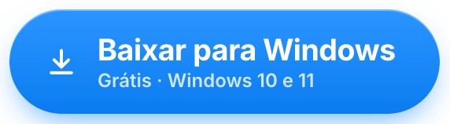
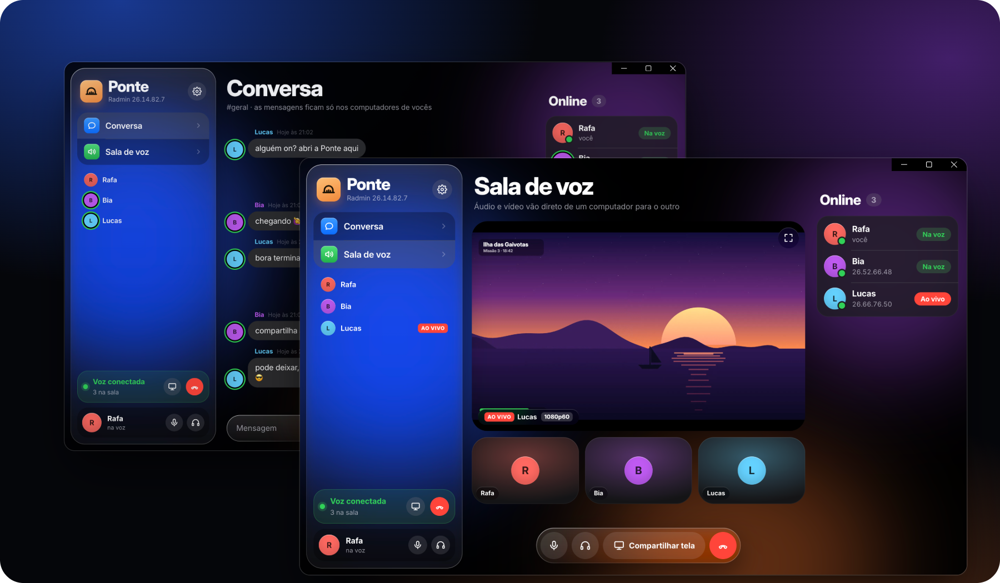
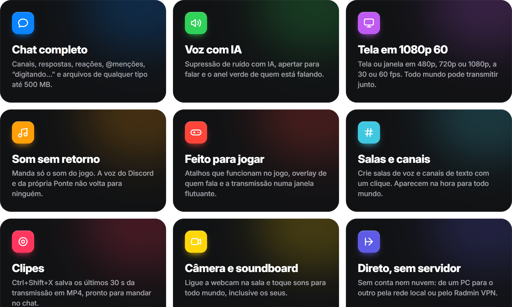
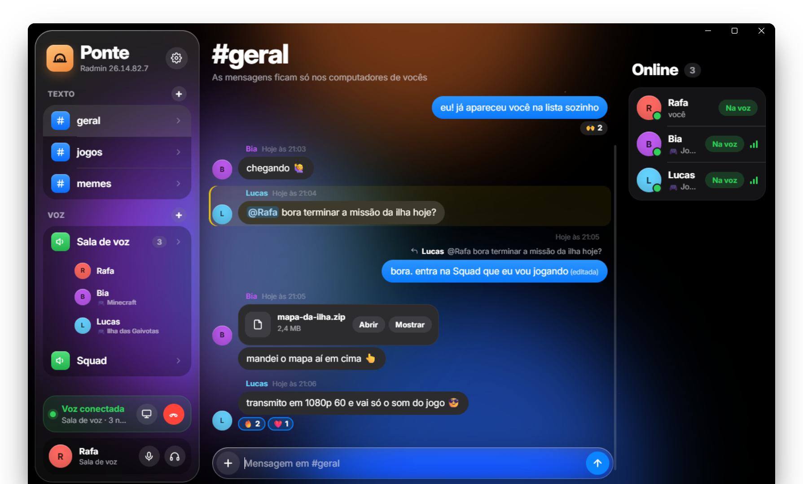
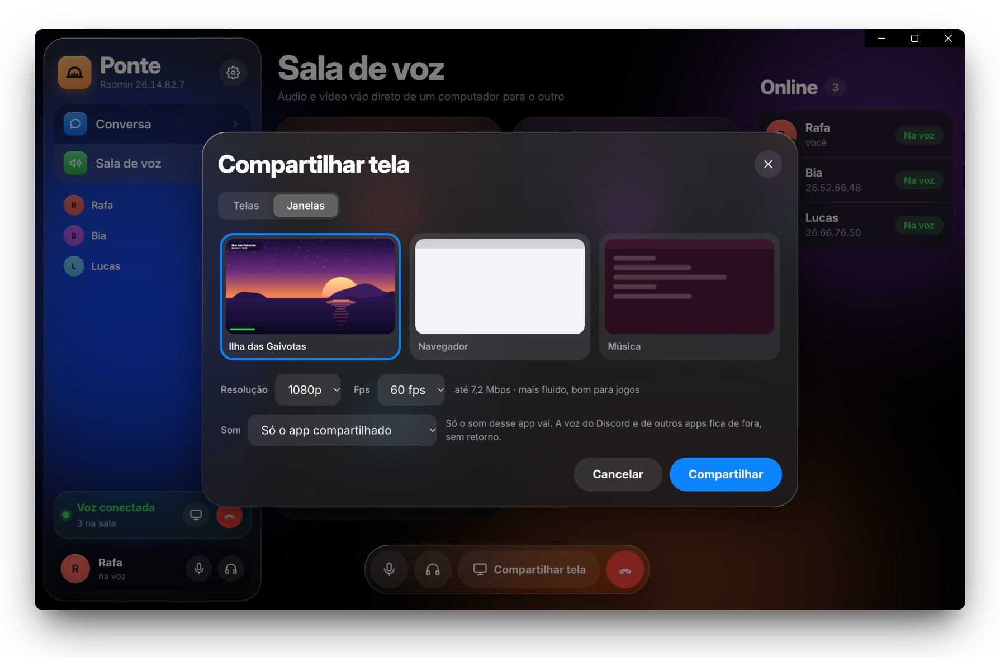
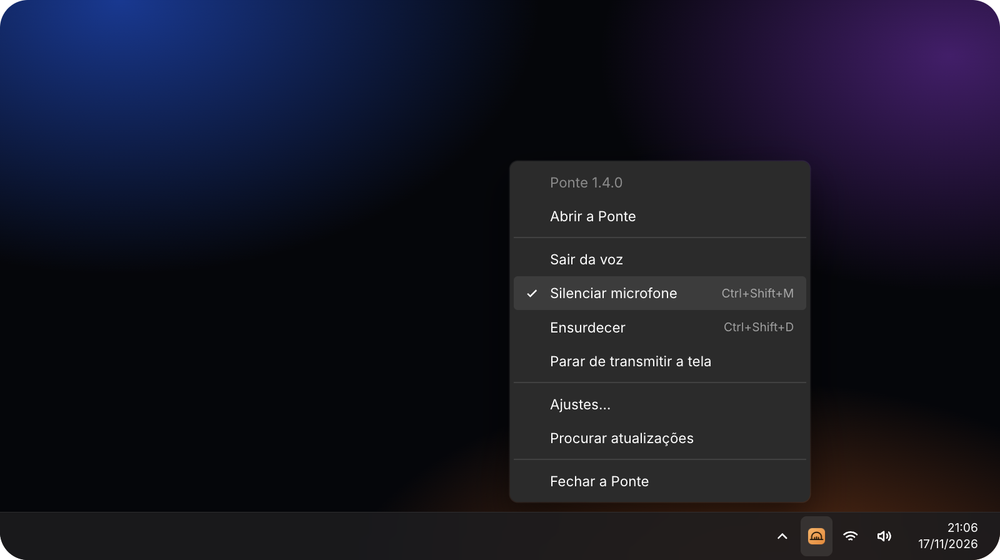
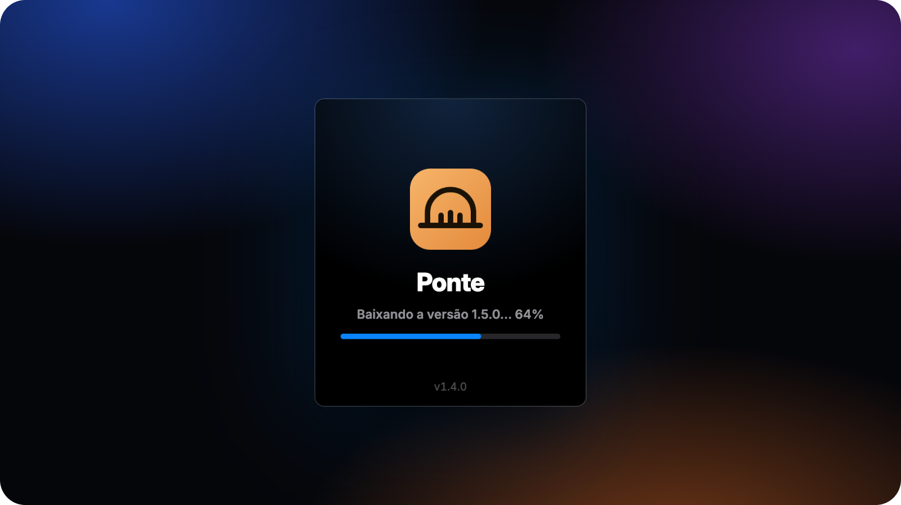
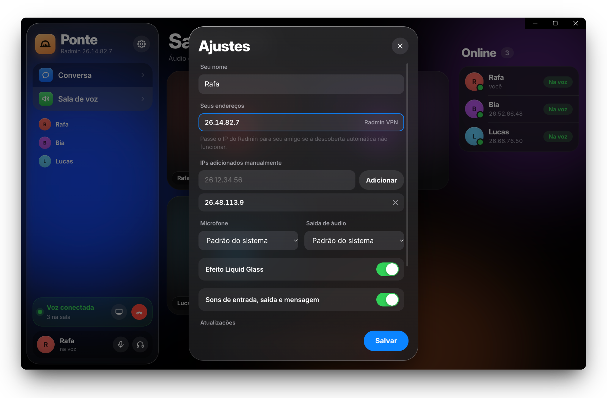
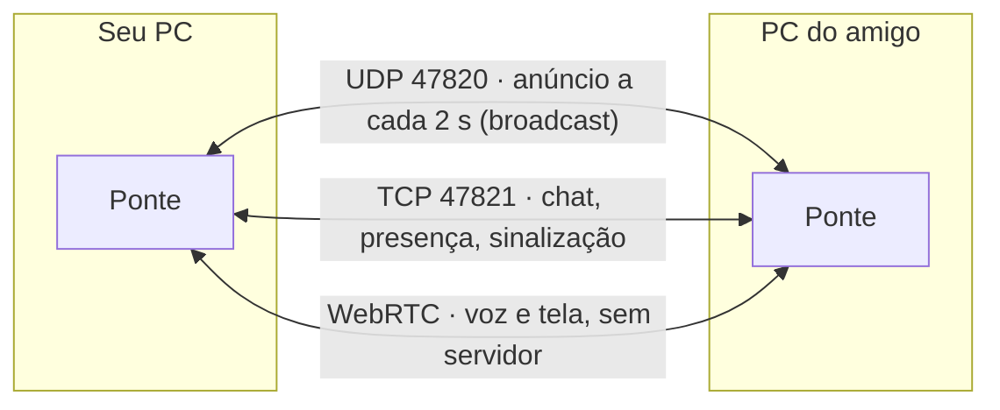

<div align="center">


# Ponte

### Chat, voz e tela entre amigos.<br>Direto de um computador para o outro.

Feita para jogar junto pelo Radmin VPN ou pela mesma rede.<br>
Sem servidor, sem conta, sem configurar nada.

<br>

<a href="https://github.com/vinceprogamations/ponte/releases/latest/download/Ponte-Instalar.exe"></a>

<sub><a href="https://github.com/vinceprogamations/ponte/releases/latest">Novidades da última versão</a> &nbsp;·&nbsp; <a href="https://github.com/vinceprogamations/ponte/releases">Todas as versões</a></sub>

<br>
<br>



</div>

<br>

<div align="center">

## Tudo para jogar junto.<br>Nada que atrapalhe.

</div>



<br>

<div align="center">

## Converse.

O canal **#geral** guarda o histórico nos computadores de vocês.<br>
Quem chega depois recebe o que perdeu assim que entra.<br>
Crie **canais** à vontade, responda, reaja, edite, apague e marque com **@nome**.<br>
Mande **qualquer arquivo** de até 500 MB: pelo **+**, arrastando para a conversa ou com Ctrl+V.

</div>



<div align="center">

## Fale como se estivesse do lado.

Cancelamento de eco e de ruído, volume separado para cada pessoa<br>
e um anel verde em volta de quem está falando.

</div>


<div align="center">

## Mostre o jogo. Com o som do jogo.

Escolha uma tela ou só a janela do jogo, em **480p, 720p ou 1080p**, a **30 ou 60 fps**.<br>
A Ponte manda **só o som daquele app**: a voz do Discord não volta para ninguém.<br>
Todo mundo pode transmitir ao mesmo tempo. Clique numa tela para ampliar, ou dê dois cliques para tela cheia.<br>
Quem assiste ajusta **o volume da transmissão** separado da voz, e os controles somem quando o mouse para.

</div>



<div align="center">

## Feito para jogar.

**Apertar para falar** com qualquer tecla ou botão do mouse, e atalhos que funcionam com o jogo na frente<br>
(**Ctrl+Shift+M** silencia, **Ctrl+Shift+D** ensurdece, **Ctrl+Shift+X** salva os últimos 30 s da transmissão).<br>
**Overlay** de quem está falando por cima do jogo, **janela flutuante** da transmissão, **supressão de ruído com IA**,<br>
**câmera**, **soundboard**, **várias salas de voz** e o status **"Jogando …"** detectado sozinho.

</div>

<div align="center">

## Fica no canto. Sempre pronta.

Fechar a janela não derruba a chamada. A Ponte fica no ícone perto do relógio,<br>
e o botão direito nele silencia, ensurdece, sai da voz, atualiza ou fecha de vez.

</div>



<div align="center">

## Sempre na versão mais nova.

Como o Discord, a Ponte procura uma versão nova toda vez que abre,<br>
baixa, instala e reabre sozinha. Com o app aberto, ela confere de novo a cada 30 minutos.

</div>



<div align="center">

## Do seu jeito.

Troque o nome, o microfone e a saída de som, adicione o IP de um amigo<br>
e ligue ou desligue o efeito **Liquid Glass** e o fundo animado.<br>
A janela se adapta a qualquer tamanho, do canto da tela ao monitor inteiro.

</div>



<br>

## Comece em um minuto

1. **Baixe o [Ponte-Instalar.exe](https://github.com/vinceprogamations/ponte/releases/latest/download/Ponte-Instalar.exe)** e dê dois cliques nele.
2. Se aparecer *"O Windows protegeu o computador"*, clique em **Mais informações → Executar assim mesmo**.
   O aviso aparece porque o app ainda não tem assinatura digital.
3. **Aceite o pedido de administrador.** O instalador coloca a Ponte em *Arquivos de Programas*, cria os
   atalhos e libera o app no firewall em todas as redes, inclusive na do Radmin, que o Windows costuma
   tratar como pública.
4. **Pronto.** A Ponte abre sozinha no final.

> [!TIP]
> Seu amigo faz a mesma coisa. Com os dois na **mesma rede do Radmin VPN** (ou no mesmo Wi-Fi), um aparece
> na lista **Online** do outro automaticamente. Nada de digitar IP.

## Perguntas frequentes

<details>
<summary><b>Meu amigo não aparece na lista. E agora?</b></summary>
<br>

- Confira se os dois estão online **na mesma rede** do Radmin e se um consegue dar `ping` no IP do outro.
- Abra **Ajustes** (engrenagem) → *IPs adicionados manualmente* e coloque o IP do Radmin do amigo, o que
  começa com `26.`.
- Em Ajustes, *Diagnóstico da rede* mostra tudo o que a Ponte está vendo.
</details>

<details>
<summary><b>Passa alguma coisa pela internet? Precisa criar conta?</b></summary>
<br>

Não. Chat, voz e tela vão direto de um computador para o outro, pela rede local ou pela VPN. Não existe
servidor da Ponte, nem conta, nem login. O histórico do chat fica salvo só nos computadores de vocês.
A única coisa que a Ponte busca na internet é a atualização, nas Releases deste repositório.
</details>

<details>
<summary><b>Quanto de rede a transmissão usa?</b></summary>
<br>

Até cerca de **7 Mbps** em 1080p a 60 fps, e bem menos em 720p ou 480p. A própria janela de compartilhar
mostra o máximo de cada opção antes de começar. A voz usa muito pouco.
</details>

<details>
<summary><b>Como fecho a Ponte de verdade?</b></summary>
<br>

Clique com o botão direito no ícone da Ponte perto do relógio e escolha **Fechar a Ponte**. O X da janela
só esconde o app, para a chamada continuar enquanto você joga.
</details>

<details>
<summary><b>Funciona no Mac ou no Linux?</b></summary>
<br>

Por enquanto o instalador é só para **Windows 10 e 11**. O código roda no macOS e no Linux pelo
`npm start` (chat, voz e tela), mas o som por app, a atualização automática e o instalador são do Windows.
</details>

<details>
<summary><b>Por que o Windows pede administrador a cada atualização?</b></summary>
<br>

A Ponte fica instalada em *Arquivos de Programas* e tem uma regra no firewall, e o Windows exige
permissão de administrador para mexer nos dois. É só aceitar: a atualização termina sozinha e o app reabre.
</details>

## Como funciona



- **Descoberta:** cada Ponte anuncia "estou aqui" por UDP no broadcast de cada placa de rede, inclusive
  `26.255.255.255` do Radmin, e por unicast para os IPs que ela já conhece.
- **Canal de controle:** uma conexão TCP por amigo leva o chat, o estado (na voz, mudo, transmitindo) e a
  negociação do WebRTC.
- **Mídia:** WebRTC ponto a ponto **sem STUN nem TURN**, usando só os IPs locais e da VPN. Se a conexão não
  sobe em cerca de 10 s, ela é refeita sozinha.
- **Som por app:** o [`native/ponte-audio.cpp`](native/ponte-audio.cpp) usa a captura de áudio por processo
  do Windows (WASAPI, Windows 10 2004 ou mais novo) e manda o som para a Ponte, que vira uma trilha do WebRTC.
- **Atualização:** o [`electron-updater`](https://www.electron.build/auto-update) lê o `latest.yml` da
  Release mais recente, baixa o instalador novo e roda em modo silencioso.

## Para desenvolvedores

<details>
<summary><b>Rodar, testar e gerar o instalador</b></summary>
<br>

Requer Node.js 22 ou mais novo. Para o som por app, também o compilador C++ do Visual Studio 2022
(workload "Desenvolvimento para desktop com C++"). O `npm run dist` compila o auxiliar sozinho.

```bash
npm install
npm start          # abre o app
npm test           # sobe dois nós locais e testa descoberta, mensagens e reconexão
npm run dist       # gera dist/Ponte-Instalar.exe e dist/latest.yml
```
</details>

<details>
<summary><b>Lançar uma versão nova</b></summary>
<br>

1. Suba a versão no `package.json` (por exemplo, `1.4.1`).
2. Crie a tag com o mesmo número e envie:

```bash
git tag v1.4.1
git push origin v1.4.1
```

O GitHub Actions confere se a tag bate com o `package.json`, gera o instalador e publica a Release com o
`Ponte-Instalar.exe`, o `.blockmap` e o `latest.yml`. As Ponte instaladas encontram a versão nova sozinhas.
</details>

<details>
<summary><b>Testar com várias janelas na mesma máquina</b></summary>
<br>

```bash
PONTE_AUTOTEST=1 PONTE_PROFILE=./perfil-a PONTE_NAME="Ana compartilha" npx electron .
PONTE_AUTOTEST=1 PONTE_PROFILE=./perfil-b PONTE_NAME="Beto" npx electron .
```

O modo de teste usa um microfone falso, entra na voz sozinho e imprime no terminal o estado da conexão e
os bytes de áudio e vídeo recebidos. Um nome com "compartilha" também transmite a tela.
`PONTE_UPDATE_TEST=1` liga o atualizador fora do app instalado.
</details>

<details>
<summary><b>Refazer as imagens deste README</b></summary>
<br>

```bash
node scripts/screenshots.js            # capturas do app em docs/img/raw/ (dados de demonstração)
npx electron scripts/readme/render.js  # molduras, banner e cartões em docs/img/
```

As capturas usam `PONTE_DEMO=1`: nomes, IPs, telas e janelas são de mentira, e nada do seu computador
aparece. Os modelos das artes ficam em [`scripts/readme/`](scripts/readme).
</details>

<details>
<summary><b>Estrutura do projeto</b></summary>
<br>

```
ponte/
├── src/
│   ├── main/              processo principal do Electron
│   │   ├── main.js        janela, captura de tela, histórico, IPC
│   │   ├── lan.js         descoberta UDP + conexões TCP (Node puro)
│   │   ├── tray.js        ícone e menu perto do relógio
│   │   ├── updater.js     atualização automática pelas Releases
│   │   └── preload.js     ponte segura entre a interface e o main
│   └── renderer/          interface (HTML/CSS/JS), Liquid Glass (glass.js) e WebRTC
│       └── update.*       janelinha "Procurando atualizações…"
├── native/                ponte-audio.cpp: captura o som de um app só
├── build/                 ícone e script extra do instalador (firewall)
├── scripts/               gerar ícone, capturas e artes do README
├── test/                  teste da camada de rede
├── docs/img/              imagens do README
└── .github/workflows/     gera o instalador e publica a Release a cada tag
```
</details>

<details>
<summary><b>Build local falhando?</b></summary>
<br>

- **Caminho muito longo:** o NSIS não aceita caminhos com mais de cerca de 260 caracteres. Coloque o
  projeto em algo como `C:\dev\ponte`.
- **`Cannot create symbolic link` (winCodeSign):** ative o *Modo de desenvolvedor* do Windows ou rode o
  terminal como administrador uma vez.
</details>

## Licença

[MIT](LICENSE). A fonte [Inter](https://rsms.me/inter/) vem junto com o app sob a
[SIL Open Font License](src/renderer/fonts/LICENSE-Inter.txt).
